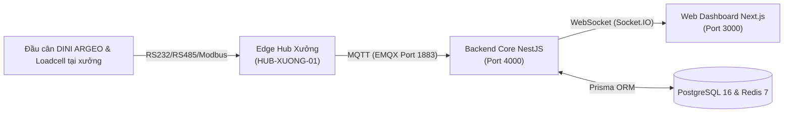
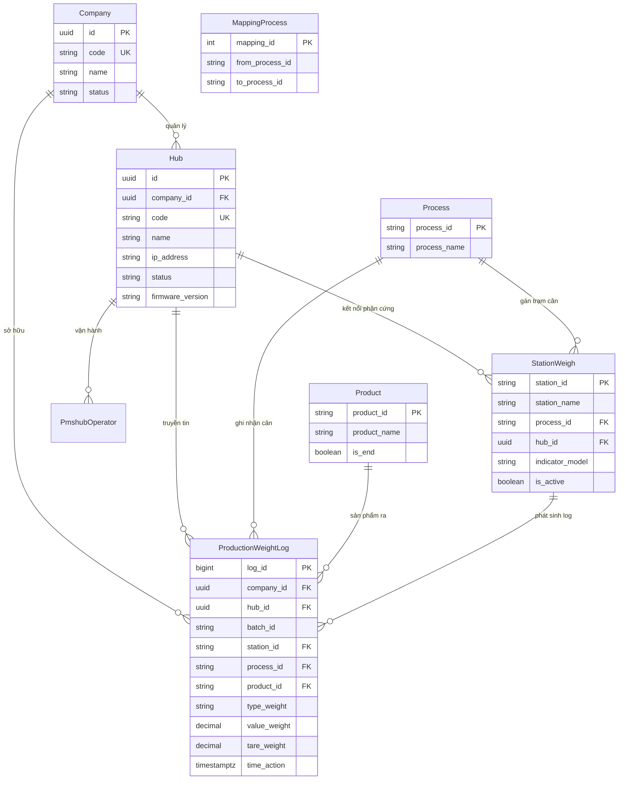
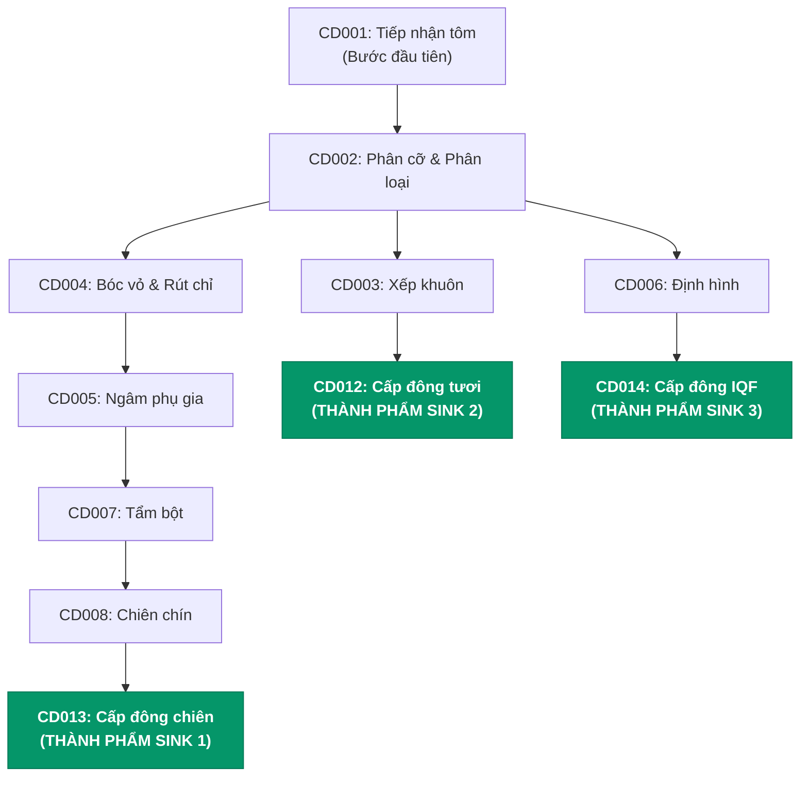
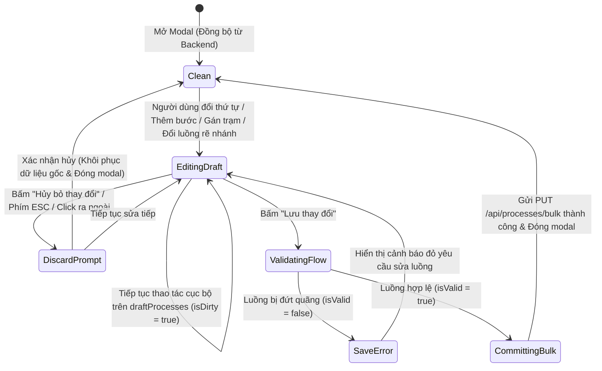
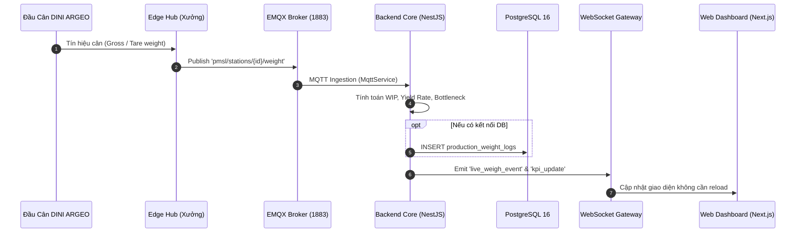
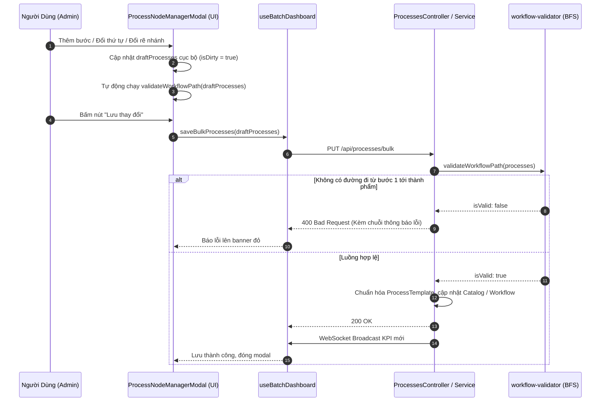

# TÀI LIỆU KIẾN TRÚC HỆ THỐNG (SYSTEM ARCHITECTURE)
## Hệ Thống Quản Lý Trạm Cân Mẻ & Giám Sát WIP Thời Gian Thực (Industrial Weigh Station & WIP Dashboard)

> **Dành cho kỹ sư phát triển (Developer & Architect Reference)**  
> **Phiên bản tài liệu:** 1.0  
> **Cập nhật lần cuối:** 15/10/2026  
> **Tiêu chuẩn áp dụng:** Nhà máy chế biến thủy sản / thực phẩm công nghiệp PMSL

---

## MỤC LỤC
1. [Tổng Quan Hệ Thống & Nghiệp Vụ](#1-tổng-quan-hệ-thống--nghiệp-vụ)
2. [Kiến Trúc Monorepo & Cây Thư Mục](#2-kiến-trúc-monorepo--cây-thư-mục)
3. [Mô Hình Dữ Liệu & Sơ Đồ Thực Thể (Database Schema)](#3-mô-hình-dữ-liệu--sơ-đồ-thực-thể-database-schema)
4. [Kiến Trúc Backend Core (`apps/backend-core`)](#4-kiến-trúc-backend-core-appsbackend-core)
   - 4.1. Cơ chế Chạy Song Song (Dual-Mode Architecture)
   - 4.2. Các Controllers & Nghiệp Vụ Chính
   - 4.3. Thuật Toán Kiểm Tra Hợp Lệ Luồng Sản Xuất (Workflow Validator)
   - 4.4. Động Cơ Tính Toán WIP & Nhận Diện Điểm Nghẽn (WIP Engine)
   - 4.5. Truyền Thông Thời Gian Thực: WebSocket & MQTT Broker
5. [Kiến Trúc Frontend Web Dashboard (`apps/web-dashboard`)](#5-kiến-trúc-frontend-web-dashboard-appsweb-dashboard)
   - 5.1. Định Tuyến & Trang Giao Diện (App Router)
   - 5.2. Quản Lý Trạng Thái Toàn Cục (`useBatchDashboard`)
   - 5.3. Cây Phân Cấp Thành Phần (Component Hierarchy)
   - 5.4. Chế Độ Lưu Nháp An Toàn (Draft / Staging Mode)
6. [Luồng Dữ Liệu Thời Gian Thực (Data Flow & Sequence)](#6-luồng-dữ-liệu-thời-gian-thực-data-flow--sequence)
7. [Bảng Tra Cứu API Endpoints & MQTT Topics](#7-bảng-tra-cứu-api-endpoints--mqtt-topics)
8. [Hướng Dẫn Dành Cho Lập Trình Viên Mới (Developer Onboarding)](#8-hướng-dẫn-dành-cho-lập-trình-viên-mới-developer-onboarding)

---

## 1. Tổng Quan Hệ Thống & Nghiệp Vụ

Hệ thống được thiết kế để giải quyết bài toán giám sát, thu thập dữ liệu IoT và tối ưu hóa năng suất trong các dây chuyền chế biến công nghiệp (tiêu chuẩn xuất khẩu thủy sản như tôm, cá...).



### Các mục tiêu nghiệp vụ cốt lõi:
1. **Theo dõi khối lượng mẻ cân thời gian thực:**
   - Khối lượng Kế hoạch (Plan Weight).
   - Khối lượng Đã hoàn thành (Completed Weight).
   - Khối lượng Đang xử lý trên chuyền (WIP - Work In Progress = `Khối lượng Vào - Khối lượng Ra`).
   - Khối lượng Còn lại cần đưa vào (Remaining Weight).
   - Tỷ lệ thu hồi sản phẩm (`Yield Rate % = Khối lượng Ra / Khối lượng Vào * 100%`).
2. **Nhận diện điểm nghẽn tự động (Bottleneck Detection):** Xác định ngay công đoạn có lượng WIP ứ đọng lớn nhất để điều phối nhân công kịp thời.
3. **Quản lý đa quy trình sản xuất (Multi-Workflow):** Hỗ trợ nhiều quy trình khác nhau (Quy trình tiêu chuẩn 15 bước, Quy trình tôm luộc IQF 9 bước, Quy trình tôm tẩm bột...) và cho phép tạo mới/nhân bản quy trình linh hoạt.
4. **Mô hình luồng rẽ nhánh (Branching Graph Flow):** Một công đoạn có thể chia luồng đi tiếp sang nhiều công đoạn khác nhau mà vẫn đảm bảo tính liên tục của dây chuyền.
5. **Giao diện Modern Industrial:** Tone màu Slate đơn sắc tối giản, tập trung vào số liệu kỹ thuật, phản hồi tức thì qua WebSocket.

---

## 2. Kiến Trúc Monorepo & Cây Thư Mục

Dự án áp dụng công nghệ **Turborepo** và **pnpm workspaces**:

```text
management_weigh/
├── apps/
│   ├── backend-core/                      # NestJS Core Server (Port 4000)
│   │   ├── src/
│   │   │   ├── main.ts                    # Điểm khởi chạy (Bootstrap), CORS, Port
│   │   │   ├── app.module.ts              # Root Module
│   │   │   ├── common/                    # Decorators, Guards (Multi-tenant, Roles)
│   │   │   └── modules/
│   │   │       ├── batch-dashboard/       # Nghiệp vụ Cân mẻ, Quy trình, Điểm nghẽn
│   │   │       │   ├── batch-dashboard.controller.ts # API /api/batches
│   │   │       │   ├── processes.controller.ts       # API /api/processes
│   │   │       │   ├── workflows.controller.ts       # API /api/workflows
│   │   │       │   ├── companies.controller.ts       # API /api/companies
│   │   │       │   ├── batch-dashboard.service.ts    # Logic lõi, In-memory cache & DB sync
│   │   │       │   ├── batch-dashboard.gateway.ts    # WebSocket Server (Socket.IO)
│   │   │       │   └── workflow-validator.ts         # Thuật toán BFS kiểm tra luồng
│   │   │       └── telemetry/             # Giao tiếp IoT Phần cứng
│   │   │           ├── mqtt.service.ts    # Kết nối EMQX Broker, nhận bản tin cân
│   │   │           └── telemetry.gateway.ts
│   │   └── package.json
│   │
│   └── web-dashboard/                     # Next.js 14 App Router (Port 3000)
│       ├── src/
│       │   ├── app/
│       │   │   ├── layout.tsx             # Root Layout & Fonts
│       │   │   ├── page.tsx               # Redirect to /dashboardsuper
│       │   │   ├── dashboardsuper/        # Trang Quản trị Hệ thống (SuperAdmin)
│       │   │   │   └── page.tsx
│       │   │   └── view-dashboard/        # Trang Giám sát Xưởng sản xuất
│       │   │       └── page.tsx
│       │   ├── components/                # Thành phần UI dùng chung
│       │   │   ├── BatchKPICards.tsx      # 4 Thẻ KPI khối lượng & Điểm nghẽn
│       │   │   ├── BatchFilterBar.tsx     # Bộ lọc Công ty, Mẻ cân & nút Mô phỏng
│       │   │   ├── WorkflowSelector.tsx   # Dropdown chọn & tạo mới Quy trình
│       │   │   ├── CreateWorkflowModal.tsx# Modal tạo/nhân bản quy trình sản xuất
│       │   │   ├── WIPMatrixTable.tsx     # Bảng dữ liệu chi tiết từng công đoạn
│       │   │   ├── WIPFlowChart.tsx       # Biểu đồ luồng sản xuất & biểu đồ cột
│       │   │   └── ProcessNodeManagerModal.tsx # Modal Cấu hình Quy trình & Trạm cân (Draft Mode)
│       │   ├── hooks/
│       │   │   └── useBatchDashboard.ts   # Hook trung tâm kết nối API & WebSocket
│       │   ├── types/
│       │   │   └── batch-flow.ts          # Type & hàm validate Workflow phía Web
│       │   └── lib/
│       │       └── formatters.ts          # Hàm định dạng kg, %, thời gian
│       └── package.json
│
├── packages/
│   ├── database/                          # Tầng CSDL Prisma
│   │   ├── prisma/
│   │   │   └── schema.prisma              # Định nghĩa bảng PostgreSQL
│   │   └── src/
│   │       ├── index.ts                   # Export PrismaClient
│   │       └── seed.ts                    # Script nạp dữ liệu mẫu
│   └── types/                             # Gói TypeScript Type/DTO dùng chung
│       └── src/
│           ├── index.ts
│           ├── pmsl.ts                    # DTOs: Process, Batch, Station, Product, KPI
│           ├── scale-telemetry.ts         # DTOs: MQTT Payload, Heartbeat
│           ├── auth.ts                    # DTOs: Authentication & Operator
│           └── ticket.ts                  # DTOs: Phiếu in ấn cân
│
├── docker/
│   └── docker-compose.dev.yml             # PostgreSQL 16, Redis 7, EMQX Broker 5.8
├── PMSL.sql                               # Dữ liệu chuẩn hệ thống cân PMSL
├── requirements.txt                       # Đặc tả phiên bản môi trường
├── turbo.json                             # Pipeline build Turborepo
└── package.json                           # Root scripts điều khiển Monorepo
```

---

## 3. Mô Hình Dữ Liệu & Sơ Đồ Thực Thể (Database Schema)

Hệ thống thiết kế theo kiến trúc **Multi-Tenant (Đa doanh nghiệp)** kết hợp tầng **Edge Hub** và **Trạm cân PMSL**:



### Ý nghĩa các bảng:
- **`companies`**: Quản lý từng nhà máy/công ty khách hàng (ví dụ: *FIMEX VN - Sao Ta*, *Minh Phú Seafood*...).
- **`hubs`**: Máy tính nhúng / máy trạm Edge đặt tại các phân xưởng (`HUB-XUONG-01`, `HUB-XUONG-02`), nhận trực tiếp dữ liệu từ các đầu cân.
- **`process` & `product`**: Danh mục công đoạn sản xuất và chủng loại/quy cách sản phẩm đầu ra.
- **`mapping_process`**: Lưu quan hệ luồng sản xuất giữa các công đoạn (`from_process_id ➔ to_process_id`).
- **`station_weigh`**: Trạm cân công nghiệp tại hiện trường, cấu hình model đầu cân (`DINI_ARGEO`) và kết nối Loadcell.
- **`production_weight_logs`**: Nhật ký lưu trữ mọi sự kiện cân: Cân Vào (`IN`) / Cân Ra (`OUT`), khối lượng tổng (`value_weight`), trừ bì khay rổ (`tare_weight`), khối lượng tịnh (`net_weight`).

---

## 4. Kiến Trúc Backend Core (`apps/backend-core`)

### 4.1. Cơ Chế Chạy Song Song (Dual-Mode Architecture)
Để đảm bảo hệ thống có thể chạy thử nghiệm ngay lập tức trên máy phát triển hoặc demo thực tế mà không bắt buộc phải có PostgreSQL sẵn:
- **Khi có PostgreSQL:** Hệ thống tự động phát hiện qua `prismaService` và đồng bộ cấu hình, mapping, log cân vào database.
- **Khi chưa có PostgreSQL:** Tự động fallback sang cấu trúc **In-memory State** được khởi tạo sẵn với 3 Công ty, 3 Mẻ sản xuất và 3 Quy trình chuẩn. Dữ liệu chạy mượt mà không bao giờ bị gián đoạn hay crash server.

### 4.2. Các Controllers & Nghiệp Vụ Chính
1. **`BatchDashboardController` (`/api/batches`)**:
   - `GET /api/batches`: Lấy danh sách các mẻ sản xuất đang chạy.
   - `GET /api/batches/:id/summary`: Trả về dữ liệu KPI chi tiết của mẻ, danh sách công đoạn, WIP, điểm nghẽn.
   - `POST /api/batches/:id/simulate-toggle`: Bật/tắt chế độ tự động mô phỏng nhịp cân.
   - `POST /api/batches/:id/simulate-tick`: Bắn 1 sự kiện cân thử nghiệm thủ công.
   - `POST /api/batches/weigh-log`: Ghi nhận sự kiện cân mới từ máy trạm.
2. **`WorkflowsController` (`/api/workflows`)**:
   - `GET /api/workflows`: Lấy danh sách toàn bộ các quy trình sản xuất đã định nghĩa.
   - `POST /api/workflows`: Tạo quy trình mới hoặc nhân bản từ quy trình nguồn (`cloneFromWorkflowId`).
   - `PUT /api/workflows/:id`: Sửa tên, mô tả quy trình.
   - `DELETE /api/workflows/:id`: Xóa quy trình (chặn xóa quy trình mặc định).
   - `POST /api/workflows/:id/assign-batch/:batchId`: Gán quy trình vào một mẻ sản xuất.
3. **`ProcessesController` (`/api/processes`)**:
   - `GET /api/processes`: Lấy danh mục công đoạn thuộc quy trình chỉ định.
   - `POST /api/processes`: Thêm công đoạn vào vị trí linh hoạt (`START`, `END`, `BEFORE`, `AFTER`).
   - `PUT /api/processes/reorder`: Đổi thứ tự sắp xếp công đoạn.
   - `PUT /api/processes/bulk`: **Cập nhật hàng loạt danh mục công đoạn sau khi chỉnh sửa trên giao diện.**
   - `PUT /api/processes/:id`: Sửa tên công đoạn, trạng thái thành phẩm.
   - `PUT /api/processes/:id/mappings`: Cấu hình danh sách các bước tiếp theo (`nextProcessIds`).
   - `DELETE /api/processes/:id`: Xóa công đoạn.
   - `POST /api/processes/:id/stations` & `DELETE :processId/stations/:stationId`: Quản lý trạm cân trực thuộc.
   - `POST /api/processes/:id/products` & `DELETE :processId/products/:productId`: Quản lý sản phẩm đầu ra.
4. **`CompaniesController` (`/api/companies`)**:
   - `GET /api/companies`: Danh mục công ty khách hàng.
   - `GET /api/companies/:companyId/hubs`: Danh sách máy Hub tại các xưởng của công ty.

---

### 4.3. Thuật Toán Kiểm Tra Hợp Lệ Luồng Sản Xuất (Workflow Validator)
Được triển khai trong `workflow-validator.ts` sử dụng thuật toán duyệt đồ thị **BFS (Breadth-First Search)**:
- **Quy tắc bất biến:** Một quy trình sản xuất hợp lệ **bắt buộc phải có ít nhất 1 đường đi hoàn chỉnh từ công đoạn đầu tiên (`processes[0]`) đến một công đoạn kết thúc/thành phẩm (Sink Node)**.
- **Định nghĩa Sink Node:** Là công đoạn không có đầu ra (`nextProcessIds` rỗng) hoặc được đánh dấu thành phẩm (`isFinalOutput: true`).
- Nếu vi phạm (luồng bị đứt đoạn, bước 1 trỏ vào ngõ cụt không tới được thành phẩm), validator sẽ chặn lại và trả về thông báo lỗi trực quan:
  `"Luồng quy trình chưa hoàn chỉnh: Không tìm thấy đường đi từ bước đầu tiên [CD001] tới bất kỳ bước thành phẩm nào."`



---

### 4.4. Động Cơ Tính Toán WIP & Nhận Diện Điểm Nghẽn (WIP Engine)
Tại mỗi mẻ sản xuất, hệ thống lưu trữ bản đồ tải trọng của từng công đoạn:
$$\text{WIP Weight} = \max(0, \text{Weight IN} - \text{Weight OUT})$$
$$\text{Yield Rate \%} = \frac{\text{Weight OUT}}{\text{Weight IN}} \times 100\%$$

**Nhận diện Bottleneck:**
Hệ thống quét toàn bộ các công đoạn trong quy trình:
$$\text{Bottleneck Process} = \arg\max_{p \in \text{Processes}} (\text{WIP Weight}_p)$$
Công đoạn có WIP dồn ứ cao nhất sẽ được gắn cờ `status = 'BOTTLENECK'` và gửi cảnh báo đỏ lên Dashboard.

---

### 4.5. Truyền Thông Thời Gian Thực: WebSocket & MQTT Broker
- **MQTT (`mqtt.service.ts`)**:
  - Broker: EMQX 5.8 (Port `1883`).
  - Lắng nghe sự kiện cân gửi từ máy Hub hoặc phần mềm cân vật lý tại trạm:
    - Topic: `pmsl/stations/{stationId}/weight` hoặc `pmsl/weight`.
    - Payload: `{ batchId, processId, stationId, productId, typeWeight: 'IN'|'OUT', valueWeight, tareWeight }`.
- **WebSocket Gateway (`batch-dashboard.gateway.ts`)**:
  - Dùng thư viện `@nestjs/websockets` và `socket.io`.
  - Khi có bản tin cân mới từ MQTT hoặc REST API:
    1. Cập nhật khối lượng vào mẻ cân.
    2. Tính toán lại toàn bộ chỉ số KPI.
    3. Phát sóng sự kiện `live_weigh_event` (hiển thị ticker cân vừa thực hiện).
    4. Phát sóng sự kiện `kpi_update` (cập nhật số liệu trên toàn bộ giao diện dashboard).

---

## 5. Kiến Trúc Frontend Web Dashboard (`apps/web-dashboard`)

### 5.1. Định Tuyến & Trang Giao Diện (App Router)
- **`/dashboardsuper`**: Màn hình dành cho Quản lý cấp cao / SuperAdmin:
  - Chọn chuyển đổi công ty khách hàng (`companies`).
  - Lựa chọn mẻ cân (`batches`).
  - Lựa chọn quy trình sản xuất (`workflows`) và gán quy trình cho mẻ.
  - Quản lý cấu hình quy trình, trạm cân và sản phẩm.
- **`/view-dashboard`**: Màn hình phân xưởng nhà máy:
  - Tự động nhận `companyId` từ phân quyền.
  - Phù hợp hiển thị trên màn hình tivi/tablet giám sát tại xưởng.

### 5.2. Quản Lý Trạng Thái Toàn Cục (`useBatchDashboard.ts`)
Tất cả trạng thái dữ liệu, WebSocket connection, gọi API REST được đóng gói trong một Custom Hook duy nhất:
- Tự động kết nối Socket.IO tới Backend Core.
- Quản lý state `metrics: BatchKPIResponse`, `workflows`, `currentCompany`, `activeWorkflow`.
- Cung cấp toàn bộ các hàm thao tác: `selectBatch`, `selectCompany`, `selectWorkflow`, `createWorkflow`, `updateProcessMappings`, `saveBulkProcesses`, `toggleSimulator`...

---

### 5.3. Cây Phân Cấp Thành Phần (Component Hierarchy)

```text
[Page: /dashboardsuper hoặc /view-dashboard]
├── <header> (Header thương hiệu, Tiêu đề, Clock)
├── <BatchFilterBar> (Bộ chọn Công ty, Mẻ cân, Nút mô phỏng, Đèn kết nối Socket)
├── <WorkflowSelector> (Dropdown chọn Quy trình, Nút "+ Tạo quy trình")
│   └── <CreateWorkflowModal> (Modal tạo/clone quy trình sản xuất)
├── <main>
│   ├── <BatchKPICards> (4 Thẻ KPI: Kế hoạch, Hoàn thành, WIP, Còn lại + Bottleneck)
│   ├── <WIPFlowChart> (Sơ đồ trực quan luồng công đoạn & Biểu đồ cột Recharts)
│   └── <WIPMatrixTable> (Bảng ma trận dữ liệu công đoạn, Nút Up/Down/Move nhanh)
└── <ProcessNodeManagerModal> (Modal Cấu hình Quy trình, Trạm cân & Sản phẩm)
```

---

### 5.4. Chế Độ Lưu Nháp An Toàn (Draft / Staging Mode)

Trong `ProcessNodeManagerModal.tsx`, toàn bộ thao tác của người dùng diễn ra theo **mô hình lưu nháp an toàn**:



#### Các điểm nổi bật của Draft Mode:
1. **Bảo vệ dữ liệu đang chạy:** Không bắn API sau mỗi lần bấm chuột, tránh làm xáo trộn dây chuyền đang sản xuất thật.
2. **Cặp nút hành động ở chân modal (Footer):**
   - Nút **"Hủy bỏ thay đổi"** (hoặc *"Đóng"* khi chưa sửa): Hủy bỏ toàn bộ các thay đổi nháp, khôi phục trạng thái ban đầu.
   - Nút **"Lưu thay đổi"** (nằm ngay kế nút Hủy): Bị disable nếu chưa có thay đổi (`!isDirty`) hoặc luồng quy trình chưa hợp lệ (`!workflowPathCheck.isValid`).
3. **Banner Flow Health thời gian thực:** Đánh giá ngay trên bản nháp xem đường đi từ bước 1 tới thành phẩm có thông suốt hay không.

---

## 6. Luồng Dữ Liệu Thời Gian Thực (Data Flow & Sequence)

### 6.1. Luồng Ghi Nhận Dữ Liệu Cân Từ Đầu Cân IoT



### 6.2. Luồng Cấu Hình Quy Trình & Lưu Hàng Loạt



---

## 7. Bảng Tra Cứu API Endpoints & MQTT Topics

### 7.1. Danh Sách REST APIs

| Nhóm | Method | Endpoint URL | Tham số / Body | Mục đích |
| :--- | :--- | :--- | :--- | :--- |
| **Mẻ cân** | `GET` | `/api/batches` | - | Lấy danh sách mẻ cân |
| | `GET` | `/api/batches/:id/summary` | `:id` | KPI mẻ cân, công đoạn, WIP, điểm nghẽn |
| | `POST` | `/api/batches/:id/simulate-toggle` | `:id` | Bật/tắt mô phỏng nhịp cân tự động |
| | `POST` | `/api/batches/:id/simulate-tick` | `:id` | Bắn 1 sự kiện cân thử nghiệm |
| | `POST` | `/api/batches/weigh-log` | `RecordWeighLogDto` | Ghi log cân từ máy trạm |
| **Quy trình**| `GET` | `/api/workflows` | - | Danh sách tất cả quy trình sản xuất |
| | `POST` | `/api/workflows` | `CreateWorkflowDto` | Tạo quy trình mới hoặc nhân bản |
| | `PUT` | `/api/workflows/:id` | `UpdateWorkflowDto` | Đổi tên/mô tả quy trình |
| | `DELETE`| `/api/workflows/:id` | `:id` | Xóa quy trình (trừ quy trình chuẩn) |
| | `POST` | `/api/workflows/:id/assign-batch/:batchId` | `:id, :batchId` | Gán quy trình vào mẻ sản xuất |
| **Công đoạn**| `GET` | `/api/processes` | `?workflowId=` | Danh sách công đoạn theo quy trình |
| | `POST` | `/api/processes` | `CreateProcessDto` | Chèn công đoạn vào Start/End/Before/After |
| | `PUT` | `/api/processes/reorder` | `ReorderProcessesDto` | Đổi thứ tự mảng công đoạn |
| | `PUT` | `/api/processes/bulk` | `{ processes: [...] }` | **Lưu hàng loạt danh mục công đoạn đã sửa** |
| | `PUT` | `/api/processes/:id` | `UpdateProcessDto` | Sửa tên công đoạn, cờ thành phẩm |
| | `PUT` | `/api/processes/:id/mappings` | `UpdateProcessMappingsDto`| Cấu hình luồng rẽ nhánh tiếp theo |
| | `DELETE`| `/api/processes/:id` | `:id` | Xóa công đoạn |
| | `POST` | `/api/processes/:id/stations` | `AddStationToProcessDto` | Gán trạm cân vào công đoạn |
| | `DELETE`| `/api/processes/:pId/stations/:sId` | `:pId, :sId` | Gỡ trạm cân khỏi công đoạn |
| | `POST` | `/api/processes/:id/products` | `AddProductToProcessDto` | Thêm sản phẩm đầu ra vào công đoạn |
| | `DELETE`| `/api/processes/:pId/products/:prId` | `:pId, :prId` | Gỡ sản phẩm đầu ra |
| **Công ty** | `GET` | `/api/companies` | - | Danh sách công ty khách hàng |
| | `GET` | `/api/companies/:id/hubs` | `:id` | Danh sách máy Hub xưởng của công ty |

### 7.2. Danh Sách MQTT Topics (EMQX Broker)

| Topic Pattern | Hướng truyền | Payload chính | Ý nghĩa |
| :--- | :--- | :--- | :--- |
| `pmsl/stations/+/weight` | Hub ➔ Backend | `{ batchId, processId, stationId, productId, typeWeight, valueWeight, tareWeight }` | Bản tin sự kiện cân mẻ theo trạm |
| `pmsl/weight` | Hub ➔ Backend | `{ batchId, processId, stationId, typeWeight, valueWeight }` | Bản tin sự kiện cân tổng quát |
| `tenants/+/hubs/+/scales/+/telemetry` | Scale ➔ Backend | `{ grossWeight, tareWeight, isStable, batteryPct }` | Trạng thái telemetry thời gian thực của cân |
| `tenants/+/hubs/+/heartbeat` | Hub ➔ Backend | `{ hubId, status: "ONLINE", timestamp, ipAddress }` | Nhịp tim kiểm tra liveness của Edge Hub |

---

## 8. Hướng Dẫn Dành Cho Lập Trình Viên Mới (Developer Onboarding)

### 8.1. Quy Ước Lập Trình (Coding Conventions)
1. **Lưu ý Monorepo Types (`packages/types`):**
   - Gói `packages/types` được biên dịch với `"build": "tsc --noEmit"`. Do đó, gói này **chỉ được chứa TypeScript `type` và `interface`**, tuyệt đối **không** đặt hàm thực thi (runtime function/class) tại đây để tránh lỗi `ERR_MODULE_NOT_FOUND` khi chạy production trên Node.js.
   - Các hàm thuật toán thực thi (như `validateWorkflowPath`) phải được đặt trực tiếp bên trong `apps/backend-core` và `apps/web-dashboard`.
2. **Quy chuẩn màu sắc giao diện (Slate Theme):**
   - Giữ vững phong cách Modern Industrial tối giản: dùng các tone `slate-900`, `slate-700`, `slate-200`, `slate-50`.
   - Các màu tín hiệu chỉ dùng khi có ý nghĩa kỹ thuật:
     - Xanh lá cây (`emerald`): Trạng thái Hoàn thành, Luồng hợp lệ.
     - Đỏ (`rose`): Điểm nghẽn (Bottleneck), Lỗi luồng đứt đoạn.
     - Vàng cam (`amber`): Cảnh báo có thay đổi chưa lưu nháp (`isDirty`).
3. **Độ chính xác số đo khối lượng:**
   - Dùng phông chữ monospace (`font-mono`) cho tất cả các con số khối lượng (kg) và mã ID (`processId`, `stationId`).

### 8.2. Danh Mục Lệnh Thao Tác Thường Dùng

```bash
# 1. Cài đặt toàn bộ thư viện
pnpm install

# 2. Khởi động hạ tầng Docker (Postgres, Redis, EMQX)
docker compose -f docker/docker-compose.dev.yml up -d

# 3. Đồng bộ cấu trúc Database Prisma (nếu dùng Postgres)
pnpm db:generate
pnpm db:push

# 4. Chạy chế độ Phát triển đồng thời cả Backend và Frontend (Hot-Reload)
pnpm dev

# 5. Build kiểm tra toàn bộ dự án trước khi commit
pnpm build

# 6. Kiểm tra lỗi cú pháp và kiểu dữ liệu TypeScript
pnpm -r exec tsc --noEmit
```

### 8.3. Danh Sách Cần Kiểm Tra Khi Thêm Tính Năng Mới (PR Checklist)
- [ ] Tính năng mới có hỗ trợ hoạt động bình thường trong cả 2 chế độ (có DB và không có DB) không?
- [ ] Nếu thay đổi liên quan đến cấu trúc công đoạn/quy trình, đã cập nhật thuật toán `validateWorkflowPath` chưa?
- [ ] Nếu chỉnh sửa modal cấu hình, tính năng có tôn trọng cơ chế **Draft / Staging Mode** (không lưu ngầm khi người dùng chưa bấm *"Lưu thay đổi"*) không?
- [ ] Giao diện có giữ đúng tone màu Slate tối giản kỹ thuật công nghiệp không?
- [ ] Đã chạy `pnpm build` và kiểm tra cả backend và frontend biên dịch thành công không có lỗi type nào chưa?
